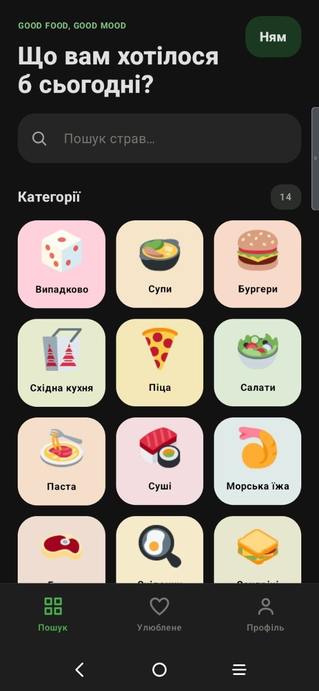
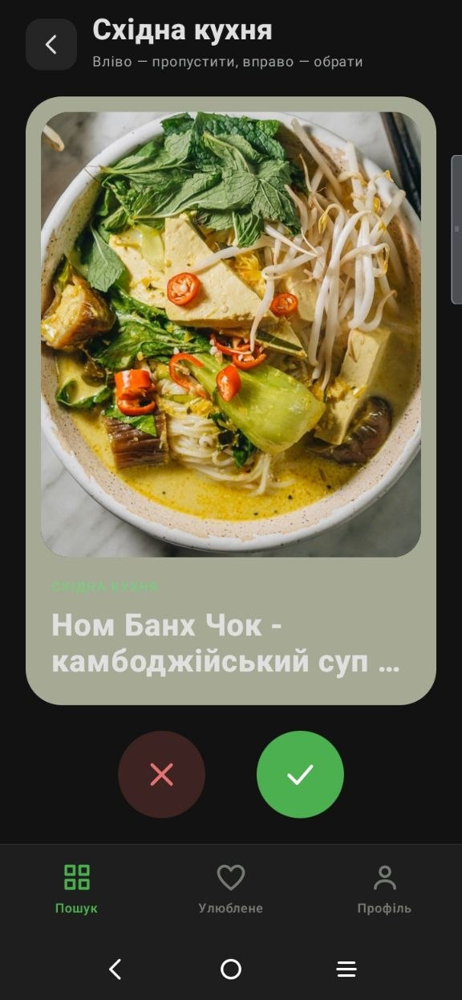
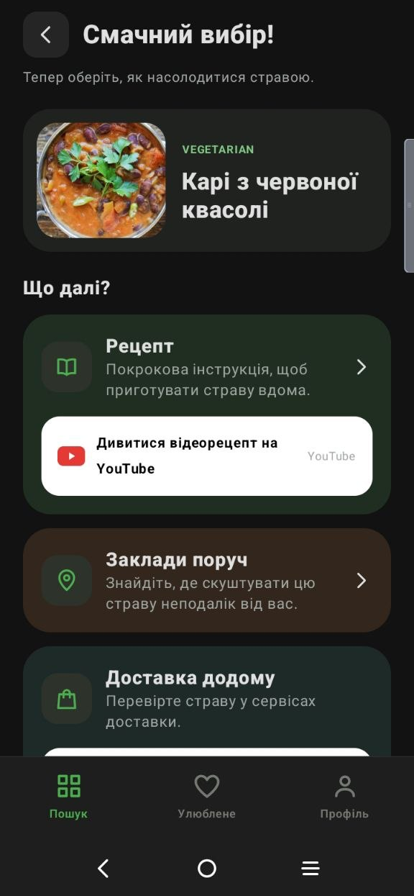
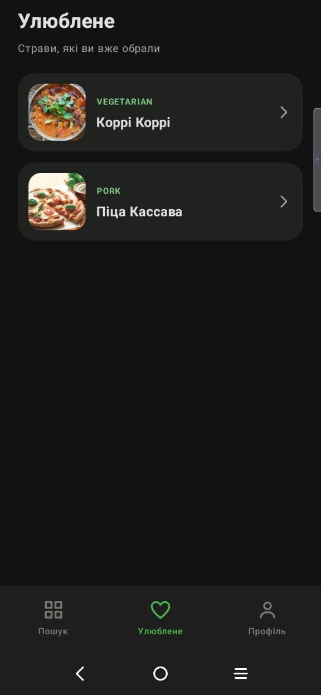
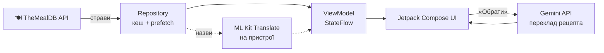

[README.md](https://github.com/user-attachments/files/34940843/README.md)
<div align="center">

<!-- 🖼️ Заміни на свій логотип: поклади файл у docs/logo.png -->


# 🍔 Tesltls

**Що сьогодні з'їсти? Просто свайпни.**

Android-застосунок для вибору та приготування їжі у стилі Tinder:<br/>
свайп карток, миттєвий пошук, ШІ-переклад рецептів і доставка в один дотик.

<br/>


[Можливості](#-можливості) •
[Як це працює](#-як-це-працює) •
[Стек](#-технологічний-стек) •
[Структура](#-структура-проєкту) •
[Запуск](#-швидкий-старт) •
[Ліцензія](#-ліцензія)

<br/>

<!-- 🎬 Додай демо-GIF: docs/demo.gif -->


</div>

---

## 💡 Про проєкт

«Що сьогодні на вечерю?» — одне з найскладніших щоденних питань. **Tesltls** перетворює відповідь на нього на гру: гортай картки зі стравами, відкидай зайве, обирай бажане й одразу отримуй рецепт, відео або доставку.

---

## ✨ Можливості

### 🎴 Картковий свайпінг

- Плавні жести з анімацією повороту та вильоту картки
- Свайп **вправо** → «Обрати» (додає в улюблені й відкриває меню дій)
- Свайп **вліво** → «Пропустити»
- **Prefetching & buffering**: наступна картка завантажується у фоні, тож перехід відбувається без затримки
- Страви не повторюються в межах сесії, а в кінці з'являється підсумкове меню

### 🔍 Реактивний пошук

- `debounce` 300 мс, щоб не робити зайвих запитів
- Результати приходять **поелементно** (`channelFlow` + `Mutex`): знайдена страва з'являється одразу, а її назва перекладається в реальному часі

### 🧠 Дворівневий переклад

| Коли | Чим | Навіщо |
|---|---|---|
| Списки й картки | **Google ML Kit Translate** (на пристрої) | Миттєво, без трафіку |
| Вибір рецепта | **Google Gemini API** | Якісний переклад назви й покрокових інструкцій |

### 📖 Рецепти та сервіси

- Покрокові інструкції приготування
- Відеорецепти на **YouTube** в один дотик
- Заклади поруч і сервіси доставки (наприклад, **Bolt Food**)

### 💖 Улюблене

- Збереження вподобаних страв
- Режим мультивибору та масове видалення

### 🌐 Мови та теми

- **7 мов:** 🇺🇦 Українська · 🇬🇧 English · 🇵🇱 Polski · 🇩🇪 Deutsch · 🇪🇸 Español · 🇫🇷 Français · 🇮🇹 Italiano
- Світла й темна теми з адаптивною палітрою Material 3

---

## 📸 Скріншоти

<!-- 🖼️ Поклади скріншоти в docs/screenshots/ і розкоментуй таблицю -->


<div align="center">


|  |  |  |  |

</div>


---

## 🔄 Як це працює



Дані з TheMealDB проходять через репозиторій (кеш і фонове підвантаження), потім через ViewModel, де назви миттєво перекладаються локально. Повний переклад інструкцій через Gemini запускається лише тоді, коли користувач обирає страву.

---

## 🏗 Технологічний стек

Застосунок побудований за принципами **Clean Architecture** та **MVVM**.

| Шар | Технології |
|---|---|
| **Мова** | Kotlin (100%) |
| **UI** | Jetpack Compose, Material 3 |
| **Навігація** | Navigation Compose 2.8+ з type-safe маршрутами (`kotlinx.serialization`) |
| **Асинхронність** | Coroutines, `Flow`, `StateFlow`, `channelFlow`, `Mutex` |
| **Мережа** | Ktor Client (OkHttp engine), Kotlinx Serialization |
| **Зображення** | Coil 3 (Compose + OkHttp) |
| **AI та переклад** | Google Gemini API (`gemini-3.1-flash-lite`), Google ML Kit Translate |
| **Дані** | [TheMealDB REST API](https://www.themealdb.com/api.php), Supabase SDK (Postgrest, Auth) |
| **Локальне сховище** | `FoodLocalStore` (SharedPreferences + JSON) |
| **DI** | Service Locator (`ServiceLocator`) |

---

## 📂 Структура проєкту

```
com.example.tesltls
├── data
│   ├── local            # Сховище: улюблені, свайпи, налаштування
│   ├── remote/mealdb    # Ktor-клієнт TheMealDB, DTO, запити
│   ├── repository       # FoodRepositoryImpl (кеш, prefetch, search flow)
│   └── translation      # GoogleTranslationService (Gemini + ML Kit)
├── di                   # ServiceLocator: єдина точка створення залежностей
├── domain
│   ├── model            # Dish, Place, PlaceWithPrice, AppLanguage...
│   └── repository       # Контракти (FoodRepository)
└── ui
    ├── common           # Допоміжні функції та розширення
    ├── components       # DishRow, DishImage, AppIcon...
    ├── details          # ActionMenu, Recipe, Places, DishDetailsViewModel
    ├── favorites        # FavoritesScreen, FavoritesViewModel
    ├── home             # HomeScreen з пошуком і категоріями, HomeViewModel
    ├── navigation       # FoodApp, NavHost, type-safe маршрути
    ├── profile          # Налаштування мови й теми
    ├── strings          # Локалізація (AppStrings)
    ├── swipe            # SwipeScreen, SwipeViewModel, SwipeDeck
    └── theme            # Кольори Material 3 (FoodColors), типографіка
```

---

## 🚀 Швидкий старт

### Вимоги

| Інструмент | Версія |
|---|---|
| Android Studio | Ladybug (2024.2.1) або новіша |
| JDK | 11+ |
| Android SDK | Compile SDK 37 · Min SDK 24 |

### Встановлення

**1. Клонуй репозиторій**

```bash
git clone https://github.com/Mishabich42/TasteIt.git
cd TasteIt
```

**2. Додай ключі** у `local.properties` у корені проєкту (опціонально)

```properties
GEMINI_API_KEY=your_gemini_api_key
SUPABASE_URL=your_supabase_url
SUPABASE_KEY=your_supabase_key
```

> 🔒 Файл `local.properties` не потрапляє в Git. Ніколи не публікуй свої ключі.

**3. Синхронізуй Gradle** в Android Studio

**4. Запусти** на пристрої чи емуляторі або зі збіркою з терміналу:

```bash
./gradlew assembleDebug
```

---

## 🤝 Внесок

Pull request'и вітаються!

1. Зроби fork репозиторію
2. Створи гілку: `git checkout -b feature/my-feature`
3. Закоміть зміни: `git commit -m "feat: add my feature"`
4. Запуш гілку: `git push origin feature/my-feature`
5. Відкрий Pull Request

---

## 🙏 Подяки

- [TheMealDB](https://www.themealdb.com/) за відкритий API зі стравами
- [Google ML Kit](https://developers.google.com/ml-kit) та [Gemini](https://ai.google.dev/) за переклад
- [Supabase](https://supabase.com/) за бекенд-інфраструктуру

---

## 📝 Ліцензія

Проєкт поширюється під ліцензією **MIT**. Деталі в файлі [LICENSE](LICENSE).

<div align="center">

<br/>

Зроблено з ❤️ і голодом 🍕

</div>
